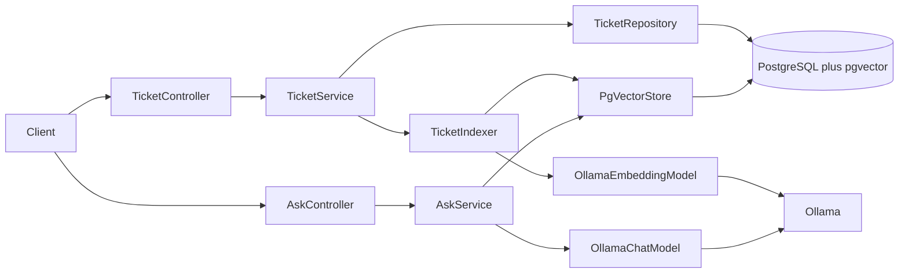

# Architecture

The service stores tickets in PostgreSQL and answers questions from those tickets. The assistant reads the vector store and never writes a ticket.

## Components

HTTP enters through two controllers. Ticket writes re-index that ticket. The assistant only retrieves chunks and calls the chat model.

`AskService` has no call into `TicketService`. A question cannot create a ticket, add a comment, change status, change assignee, or write resolution notes.

## Package layout

Code sits in five packages under `tickets`. Controllers map HTTP. Services own transitions and retrieval. Repositories own rows. Domain owns the ticket and its status rules. `ai` owns chunking, indexing, and the assistant prompt.

| Package | Owns | Does not own |
|---|---|---|
| `tickets.controller` | `/api/tickets`, `/api/tickets/{id}/comments`, `/api/ai/ask`, `@Valid`. List accepts `page`, `size`, `keyword`, and `status`. | Status rules, SQL, prompts |
| `tickets.service` | `@Transactional` writes, FR-7 transitions | HTTP, embeddings |
| `tickets.repository` | Ticket and comment rows | Vector search |
| `tickets.domain` | Ticket, comment, resolution notes, and the five statuses in `spec/state-machine.md` | Spring types |
| `tickets.ai` | Chunks, delete-then-insert, retrieval, and the system prompt. Ingestion rules are in `spec/rag-ingestion.md`. | Ticket status changes |

**Trade-offs.** Five packages match the layering rule and keep the assistant off the write path. A single `service` package would make the "no writes from the assistant" boundary harder to test. Splitting `ai` into more packages would add folders before there is a second model or a second index.

## Technology choices

The runtime is Java 21, Spring Boot 3, Spring AI, PostgreSQL 16 with pgvector, and Ollama on the same network.

| Choice | Decision | Alternative |
|---|---|---|
| Language and framework | Java 21 and Spring Boot 3 | An older Java baseline would drop records and the Spring Boot 3 starters |
| Ticket store | PostgreSQL 16, database `tickets` | A second database would split tickets from their vectors |
| Vector store | Spring AI `PgVectorStore` in that same database | An external vector service would add a network hop and a second copy of ticket text |
| Embeddings | Ollama `nomic-embed-text`, 768 dimensions | A cloud embedding API, compared below |
| Chat | The model named by `spring.ai.ollama.chat.options.model` | A cloud chat model would receive the retrieved ticket text |
| Secrets | `DB_PASSWORD` and other secrets from the environment | A value in source or Compose fails NFR-4 |

**Trade-offs.** One Postgres holds both the ticket rows and the vectors, so a ticket and its chunks commit together and delete-then-insert stays in one database. The chat model is whatever `spring.ai.ollama.chat.options.model` names. Local chat keeps the retrieved ticket text on the machine. A cloud chat model would send that text off the network even if embeddings stayed local.

## Chunking strategy

Each ticket is stored as section chunks: one chunk for the description, one chunk per comment, and one chunk for the resolution notes. Empty sections are skipped. A description of 500 words or fewer is one chunk. A word is a run of non-whitespace characters. A longer description is split into consecutive parts of 500 words. Part 1 is words 1 through 500. Each part stores `partIndex` starting at 1. A description of 500 words or fewer has no `partIndex`.

The brainstorm compared paragraph, fixed-size, and semantic splits for tickets that are usually under 500 words and already have a description, comments, and resolution notes. Section boundaries are the split. A comment group is one comment, which is the grouping FR-9 can count.

| Strategy | What happens to a short ticket | Result |
|---|---|---|
| Paragraph | Blank lines decide the split. A one-line comment becomes a tiny chunk. A description with no blank line stays one blob. | Boundaries follow typing, not the ticket fields. |
| Fixed-size | A window near 500 words often holds the complaint and the fix in one vector. A smaller window cuts through a section. Overlap stores the same text twice. | A question about the fix retrieves the complaint with equal weight. |
| Semantic | Sentences are embedded at index time and split where similarity drops. On this data those drops are usually the section boundaries already stored. | Extra embedding pass, and a short comment can be cut into a piece too small to answer how the ticket was resolved. |
| Section | Description, each comment, and resolution notes are separate chunks. Text is prefixed with the ticket id and the section name. | Use this. Retrieval can land on the fix or on one comment. |

Each chunk stores `ticketId`, `status`, `priority`, `assignee`, `category`, and `sectionType` (`description`, `comment`, or `resolution`). Comment chunks also store `groupIndex`, equal to that comment's order. A description split past 500 words stores `partIndex` on each part.

**Trade-offs.** Section chunks keep the resolution searchable without dragging the whole thread into one vector. They cost more rows than a single chunk per ticket, and a question that needs the whole story depends on top-K to bring the sibling sections back. A description longer than 500 words gains one chunk per 500 words, and those parts can crowd out another ticket inside top-K. Paragraph, fixed-size, and semantic splits ignore fields the ticket already has. No chunking benchmark was run on this corpus.

## Embedding model

Chunks are embedded with local Ollama `nomic-embed-text`. Each stored vector has length 768. Ticket text can contain customer details, re-ingestion sends the ticket through the model again, and the index has to build without a network call to a vendor.

| Dimension | Local `nomic-embed-text` | A cloud embedding API |
|---|---|---|
| Cost | No per-token fee. Cost is the machine running Ollama. Re-embedding a ticket adds no API bill. | Billed per token. Delete-then-insert sends the ticket text again. |
| Latency | No network hop. Throughput is capped by that machine, including model load. | Provider accelerators, plus a network round trip and the provider's rate limits. |
| Quality | A retrieval embedding model. Accuracy on this ticket wording is unmeasured. | Often stronger on public retrieval leaderboards. That gap is not measured on these tickets. |
| Privacy and offline | Ticket text stays on the network. Embedding works after the model is pulled. | Ticket text leaves the network. Embedding stops when the provider is unreachable. |

**Trade-offs.** Local embeddings win on cost of re-ingestion, privacy, and offline use. Latency is unmeasured, and so is quality on this corpus, so those two columns are not a reason to switch. Move to a cloud model only after a labeled question set shows the local model misses tickets the cloud model retrieves, and set a new similarity threshold at the same time. Scores from two models are not on the same scale. No price, millisecond figure, or leaderboard score is claimed here.

## Retrieval configuration

Retrieval size and the cutoff are configuration, both overridable without a code change.

| Property | Default | Effect |
|---|---|---|
| `app.rag.top-k` | `5` | Maximum chunks passed to the chat model after the threshold. |
| `app.rag.similarity-threshold` | `0.6` | Minimum similarity. A higher score means a closer chunk. |

`spring.ai.ollama.embedding.options.model` is `nomic-embed-text`. The vector column length is 768. The chat model name is `spring.ai.ollama.chat.options.model`.

**Trade-offs.** Defaults of 5 and 0.6 match NFR-6. Five chunks cover a description, a comment, and a resolution plus one neighbor. The cutoff is a minimum similarity of `0.6`. A higher score is a closer chunk. When the store returns a cosine distance, `similarity = 1 - distance` before that comparison. The labeled questions and the sweep are in `spec/evaluation-strategy.md`. Raise the threshold when the wrong ticket is cited or a question that should be refused gets an answer. Lower it when a relevant ticket scores just under the gate. Change top-K only after the threshold, and only when the right ticket is stored but missing from the context.
