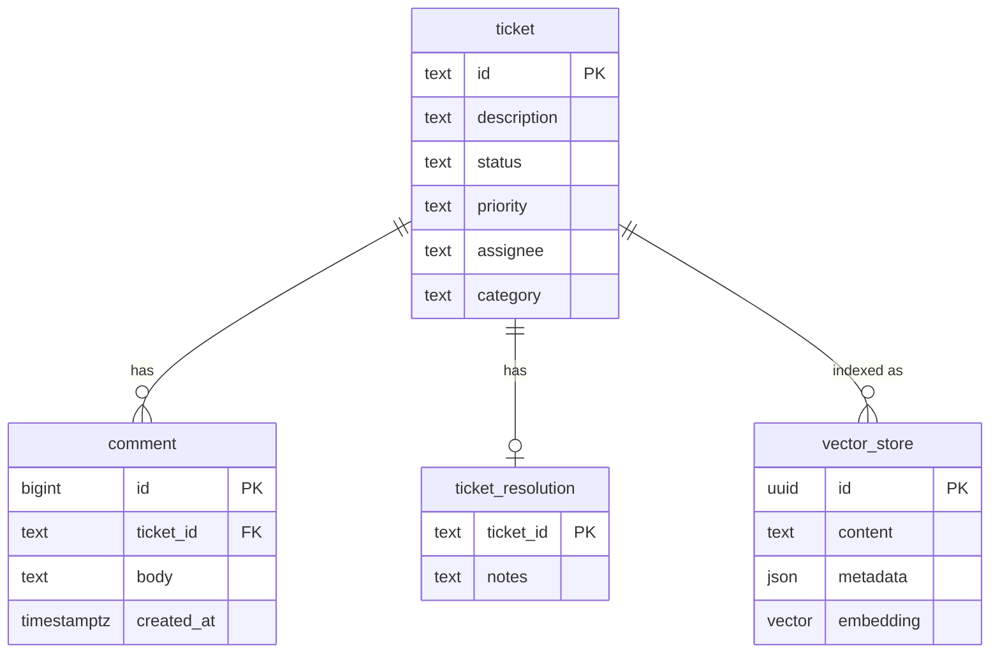

# Data model

Tickets, comments, and resolution notes live in PostgreSQL tables. Their text is copied into `vector_store` for retrieval. The vector rows are not foreign keys.

## ticket

A ticket is one row. `id` is the public id returned by `POST /api/tickets`.

| Column | Type | Constraints |
|---|---|---|
| `id` | `text` | Primary key. Check `id ~ '^TKT-[0-9]+$'`. |
| `description` | `text` | Not null. Check `length(btrim(description)) > 0`. |
| `status` | `text` | Not null. Default `OPEN`. Check `status in ('OPEN', 'IN_PROGRESS', 'RESOLVED', 'CLOSED', 'CANCELLED')`. |
| `priority` | `text` | Not null. Check `priority in ('HIGH', 'MEDIUM', 'LOW')`. |
| `assignee` | `text` | Null until set. |
| `category` | `text` | Not null. Check `length(btrim(category)) > 0`. |

| Index | Columns | Purpose |
|---|---|---|
| `ticket_pkey` | `id` | Lookup by `GET /api/tickets/{id}` and list pagination. |

## comment

Each comment is one row and one vector chunk. `created_at` then `id` is the comment order used as `groupIndex`.

| Column | Type | Constraints |
|---|---|---|
| `id` | `bigint` | Primary key. `GENERATED ALWAYS AS IDENTITY`. |
| `ticket_id` | `text` | Not null. Foreign key to `ticket(id)` on delete cascade. |
| `body` | `text` | Not null. Check `length(btrim(body)) > 0`. |
| `created_at` | `timestamptz` | Not null. Default `now()`. |

| Index | Columns | Purpose |
|---|---|---|
| `comment_pkey` | `id` | Identity. |
| `comment_ticket_id_idx` | `ticket_id, created_at, id` | Load one ticket's comments in order. |

## ticket_resolution

A ticket has at most one resolution row. No row means the resolution notes are empty, so the indexer stores no resolution chunk.

| Column | Type | Constraints |
|---|---|---|
| `ticket_id` | `text` | Primary key. Foreign key to `ticket(id)` on delete cascade. |
| `notes` | `text` | Not null. Check `length(btrim(notes)) > 0`. |

| Index | Columns | Purpose |
|---|---|---|
| `ticket_resolution_pkey` | `ticket_id` | One resolution per ticket. |

**Trade-offs.** A separate `ticket_resolution` table keeps an unresolved ticket free of an empty notes column and matches "no chunk when notes are empty." A `notes` column on `ticket` would make the row wider and would need a second rule to ignore blanks. The cascade delete removes comments and the resolution with the ticket. The assistant never deletes tickets.

## Relationships

`comment` and `ticket_resolution` reference `ticket`. `vector_store` points at a ticket only through `metadata.ticketId`.

## vector_store

Spring AI `PgVectorStore` owns this table. The embedding length is 768 for `nomic-embed-text`. Re-ingestion deletes rows for one `ticketId`, then inserts the new chunks.

| Column | Type | Constraints |
|---|---|---|
| `id` | `uuid` | Primary key. Default `uuid_generate_v4()`. |
| `content` | `text` | Not null. Section text, prefixed with the ticket id and section name. |
| `metadata` | `json` | Not null. Fields below. |
| `embedding` | `vector(768)` | Not null. |

| Index | Columns | Purpose |
|---|---|---|
| `vector_store_pkey` | `id` | Row identity. |
| `vector_store_embedding_idx` | `embedding` using HNSW `vector_cosine_ops` | Cosine nearest-neighbor search. |
| `vector_store_ticket_id_idx` | `(metadata->>'ticketId')` | Delete-then-insert for one ticket. |

### Metadata fields

Every chunk carries the five ticket fields. `sectionType` is required by FR-9. `groupIndex` is present only on comment chunks.

| Field | JSON type | Rule |
|---|---|---|
| `ticketId` | string | Required. Equals `ticket.id`. |
| `status` | string | Required. Equals `ticket.status` at index time. |
| `priority` | string | Required. Equals `ticket.priority`. |
| `assignee` | string or null | Required key. Null when `ticket.assignee` is null. |
| `category` | string | Required. Equals `ticket.category`. |
| `sectionType` | string | Required. `description`, `comment`, or `resolution`. |
| `groupIndex` | number | Comment chunks only. `1` for the earliest comment. |
| `partIndex` | number | Description chunks only when the description is longer than 500 words. `1` for the first 500 words. |

| Store | How a ticket id is kept | What a delete of one ticket can use |
|---|---|---|
| `metadata` JSON | Spring AI filter and the `ticketId` index | `metadata->>'ticketId'` |
| Typed columns on `vector_store` | A real foreign key | A column index, and a schema Spring AI does not create by default |

**Trade-offs.** JSON metadata matches Spring AI `PgVectorStore` and still indexes `ticketId` for FR-10. Typed columns would give a foreign key, and they would fight the table Spring AI creates. There is no database guarantee that `metadata.ticketId` exists. The indexer must write it on every chunk. HNSW fits cosine search as the table grows. A sequential scan would be enough for a handful of tickets and would change the plan later. No index-build benchmark is claimed.
