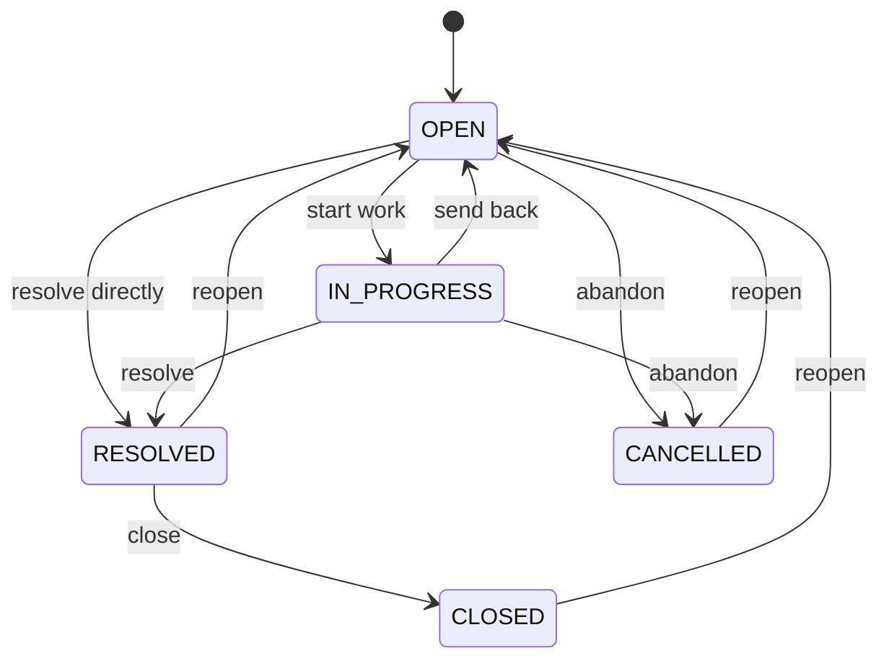

# Ticket state machine

A ticket is `OPEN`, `IN_PROGRESS`, `RESOLVED`, `CLOSED`, or `CANCELLED`. Creation stores `OPEN`. A later status change is allowed only when the matrix says Allowed.

The diagram shows allowed moves. Every other pair, including a move to the same state, is forbidden.



## Transition matrix

Rows are the stored status. Columns are the requested status. Allowed returns `200`. Forbidden returns `409`.

| From \ To | `OPEN` | `IN_PROGRESS` | `RESOLVED` | `CLOSED` | `CANCELLED` |
|---|---|---|---|---|---|
| `OPEN` | Forbidden | Allowed | Allowed | Forbidden | Allowed |
| `IN_PROGRESS` | Allowed | Forbidden | Allowed | Forbidden | Allowed |
| `RESOLVED` | Allowed | Forbidden | Forbidden | Allowed | Forbidden |
| `CLOSED` | Allowed | Forbidden | Forbidden | Forbidden | Forbidden |
| `CANCELLED` | Allowed | Forbidden | Forbidden | Forbidden | Forbidden |

| Policy | How `CLOSED` and `CANCELLED` behave | Result |
|---|---|---|
| Terminal | No path back to `OPEN` | A mistaken close or cancel cannot be repaired |
| Reopen only to `OPEN` | `CLOSED` to `OPEN` and `CANCELLED` to `OPEN` | One door back into the workflow already used by `RESOLVED` |
| Free movement | Any state to any other state | Drops the pairs FR-7 already forbids, such as `RESOLVED` to `IN_PROGRESS` |

**Trade-offs.** Reopen only to `OPEN` keeps the five pairs already required and adds cancel, close, and reopen. `CLOSED` is reachable only from `RESOLVED`, so a closed ticket has been resolved. `CANCELLED` is reachable only from `OPEN` or `IN_PROGRESS`, so a resolved ticket is not abandoned by a cancel. A terminal `CLOSED` would make a wrong close permanent. Free movement would mark forbidden pairs as allowed.

## Forbidden move

A forbidden pair does not change the ticket and does not re-ingest it. The response is `409` with an empty `fieldErrors` array.

```json
{
  "timestamp": "2026-10-23T14:00:00Z",
  "status": 409,
  "error": "Conflict",
  "message": "Status cannot change from RESOLVED to IN_PROGRESS",
  "fieldErrors": []
}
```

The message names the stored status and the requested status. A value outside the five statuses is `400`, not `409`.

## Side effects

An allowed transition updates `ticket.status`, then delete-then-insert re-ingests that ticket so chunk metadata `status` matches. Comments and resolution notes stay unless the same request changes them. One successful status change causes one re-ingestion.

| Transition | HTTP | Side effects |
|---|---|---|
| `OPEN` to `IN_PROGRESS` | `200` | Store `IN_PROGRESS`. Re-ingest. |
| `OPEN` to `RESOLVED` | `200` | Store `RESOLVED`. Re-ingest. Does not create resolution notes. |
| `OPEN` to `CANCELLED` | `200` | Store `CANCELLED`. Re-ingest. Keep comments and any resolution row. |
| `IN_PROGRESS` to `OPEN` | `200` | Store `OPEN`. Re-ingest. |
| `IN_PROGRESS` to `RESOLVED` | `200` | Store `RESOLVED`. Re-ingest. Does not create resolution notes. |
| `IN_PROGRESS` to `CANCELLED` | `200` | Store `CANCELLED`. Re-ingest. Keep comments and any resolution row. |
| `RESOLVED` to `CLOSED` | `200` | Store `CLOSED`. Re-ingest. Keep resolution notes. |
| `RESOLVED` to `OPEN` | `200` | Store `OPEN`. Re-ingest. Keep resolution notes. |
| `CLOSED` to `OPEN` | `200` | Store `OPEN`. Re-ingest. Keep comments and resolution notes. |
| `CANCELLED` to `OPEN` | `200` | Store `OPEN`. Re-ingest. Keep comments and resolution notes. |
| Any Forbidden pair | `409` | No row change. No re-ingestion. |

Creation is not a transition. `POST /api/tickets` inserts `OPEN` and ingests once. A comment or a resolution-note edit re-ingests in whatever status the ticket already has, and it is not a move on this diagram.
